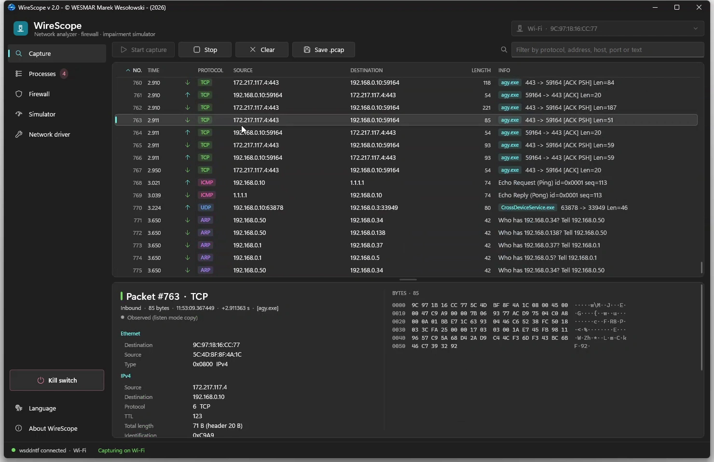
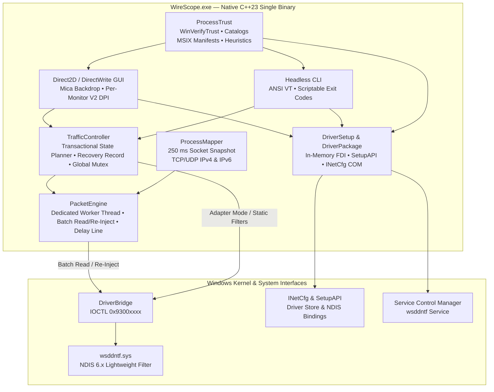
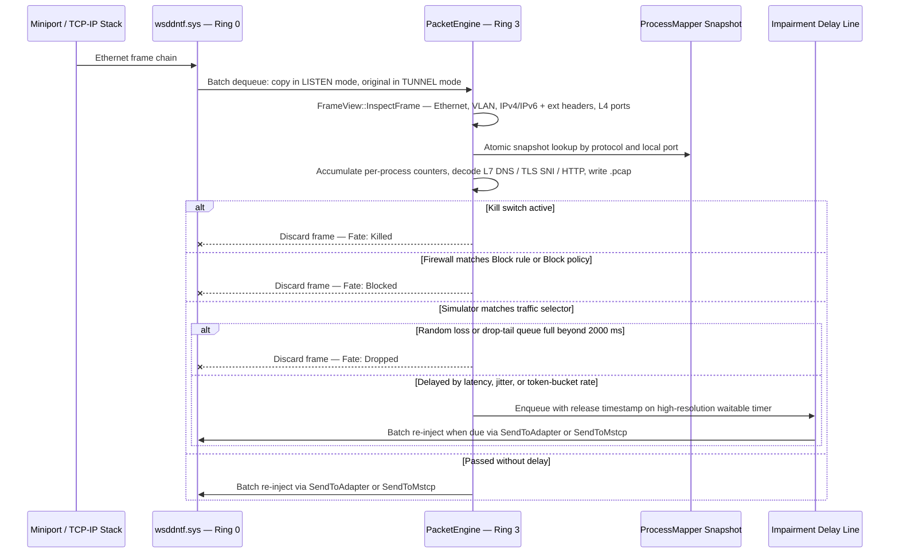
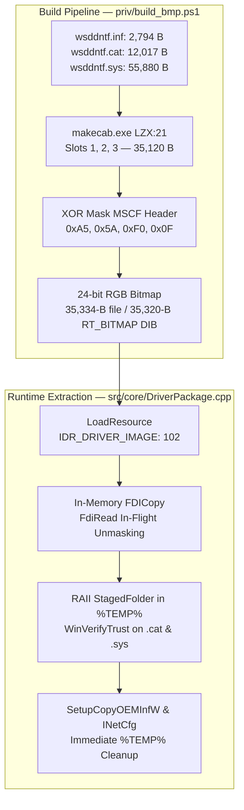
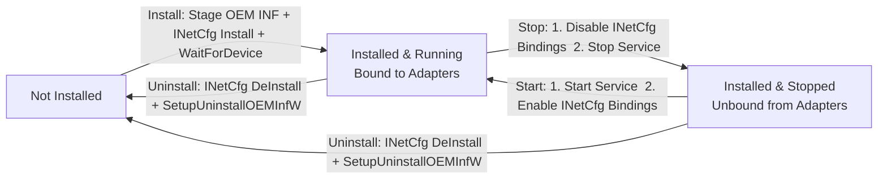

<div align="center">

[](https://www.youtube.com/watch?v=gAAt8bULX5U)

*▶ Click above to watch the WireScope demonstration on YouTube (35s, 1080p 60fps)*

<br><br>



[](https://github.com/wesmar/WireScope/releases/tag/latest)
[](#-release-archive-and-integrity)
[](LICENSE.md)
[]()
[]()
[]()
[]()
[-16a34a.svg)](#localization)
[](https://www.youtube.com/watch?v=gAAt8bULX5U)

</div>

> ## 🔑 Archive Password: `github.com`
>
> **Password required to extract `WireScope.7z`:** `github.com`
> Encrypted with password `github.com` to prevent browser download filters and antivirus false positives on unsigned network binaries and drivers.

> **Engineering Status**
>
> `WireScope.exe` is a single native C++23 executable that combines Layer 2 packet capture, per-process traffic accounting, stateful firewall enforcement, network impairment simulation, and NDIS filter lifecycle management on one data plane. It communicates directly with the NDIS 6.x lightweight filter driver `wsddntf.sys` over the `0x9300xxxx` IOCTL protocol, requiring neither Npcap nor third-party user-mode libraries. The signed driver package is embedded inside the executable as an LZX-compressed steganographic bitmap resource at `src/resources/WireScope.bmp` and deployed on demand through the Windows `SetupAPI` and `INetCfg` COM interfaces. Verified on Windows 11 x64 across 23 network interfaces: directional firewall rules, per-application blocking, token-bucket bandwidth shaping at 512 kbit/s, 200 ms delay injection with ~1 ms timer granularity, and live filter detachment with zero ICMP packet loss.

> **Repository Policy:** Git tracks the C++23 source code, project files, build and verification scripts, language files, the string table generator `tools/strings.py`, and the embedded resource carrier `src/resources/WireScope.bmp`. Build outputs in `bin/` and `obj/`, packet captures, and private staging scripts remain outside the repository.

# WireScope — Packet Capture, Per-Process Monitor, Firewall, and Link Simulator on One Kernel Data Plane

<br>

<div align="center">

**Single-File Executable • Layer 2 NDIS Inspection • Per-Socket Process Attribution • Token-Bucket Shaping • Self-Healing Data Plane**

*Built exclusively on the Windows SDK and the C++23 standard library — Direct2D on Mica for the interface, deterministic English output for the command line*

</div>

---

## Table of Contents

- [Quick Start](#quick-start)
  - [1. Graphical Interface](#1-graphical-interface)
  - [2. Command Line](#2-command-line)
  - [3. Typical Workflows](#3-typical-workflows)
- [Technical Overview](#technical-overview)
- [System Architecture](#system-architecture)
- [The Packet Data Path](#the-packet-data-path)
- [Steganographic Driver Packaging and Deployment](#steganographic-driver-packaging-and-deployment)
  - [Carrier Construction — `WireScope.bmp`](#carrier-construction--wirescopebmp)
  - [In-Memory FDI Decompression and RAII Staging](#in-memory-fdi-decompression-and-raii-staging)
  - [Comparison with MZ Header Truncation in KvcKiller](#comparison-with-mz-header-truncation-in-kvckiller)
  - [Mandatory Filter Semantics and Zero-Drop Detachment](#mandatory-filter-semantics-and-zero-drop-detachment)
- [Reverse Engineering `wsddntf.sys` and the `0x9300xxxx` IOCTL Protocol](#reverse-engineering-wsddntfsys-and-the-0x9300xxxx-ioctl-protocol)
  - [1. Binary Identity and Provenance](#1-binary-identity-and-provenance)
  - [2. PE Section Layout and Kernel Imports](#2-pe-section-layout-and-kernel-imports)
  - [3. NDIS 6.x Stack Position and Hook Entry Points](#3-ndis-6x-stack-position-and-hook-entry-points)
  - [4. Two-Tier `IRP_MJ_DEVICE_CONTROL` Dispatch](#4-two-tier-irp_mj_device_control-dispatch)
  - [5. Complete 28-Code IOCTL Dispatch Table](#5-complete-28-code-ioctl-dispatch-table)
  - [6. `INTERMEDIATE_BUFFER` Layout and Pointer Probing](#6-intermediate_buffer-layout-and-pointer-probing)
  - [7. Static Filter ABI and Kernel Enforcement in LISTEN and TUNNEL Modes](#7-static-filter-abi-and-kernel-enforcement-in-listen-and-tunnel-modes)
  - [8. Clarification of `0xFCxxxxxx` Constants in `FilterOidRequest`](#8-clarification-of-0xfcxxxxxx-constants-in-filteroidrequest)
- [Functional Modules](#functional-modules)
  - [Capture](#capture)
  - [Processes and Authenticode Verification](#processes-and-authenticode-verification)
  - [Firewall and Rule Language](#firewall-and-rule-language)
  - [Network Impairment Simulator](#network-impairment-simulator)
  - [Kill Switch and Safety Mechanisms](#kill-switch-and-safety-mechanisms)
- [Command-Line Reference](#command-line-reference)
  - [Exit Codes](#exit-codes)
- [Graphical Interface Design](#graphical-interface-design)
- [Localization](#localization)
- [Source Layout](#source-layout)
- [Building from Source](#building-from-source)
- [License](#license)

---

## Quick Start

`WireScope.exe` operates as a Direct2D desktop application when launched without arguments and as a scriptable console tool when invoked with command-line flags. Both modes drive the same `TrafficController` and `PacketEngine`.

### 1. Graphical Interface
1. Run `WireScope.exe` with administrator privileges; when started unprivileged, the header bar provides **Restart as administrator**.
2. If the `wsddntf` driver is not yet present on the machine, open the **Network driver** page via `Ctrl+5` and click **Install** — WireScope unpacks the embedded signed driver package from its own resources, stages it in the Windows Driver Store, and attaches the filter.
3. Select the target network interface in the top bar; the adapter carrying the default IPv4 route is selected first.
4. Use **Capture** via `Ctrl+1` or `F5` to inspect frames, **Processes** via `Ctrl+2` to monitor per-application bandwidth and digital signatures, **Firewall** via `Ctrl+3` to enforce directional rules, and **Simulator** via `Ctrl+4` to shape latency, jitter, packet loss, and throughput.

### 2. Command Line
```cmd
:: Validate and explain firewall rules and simulator parameters without touching the driver
WireScope.exe --check --rule "block out tcp dport 443" --rule "block app discord.exe" --rate 512

:: Enforce a firewall rule set for 60 seconds, then restore the adapter state
WireScope.exe --rule "block udp rport 27015-27030" --rule "block in icmp type 8" --duration 60

:: Measure per-process network traffic over 30 seconds in non-intrusive listen mode
WireScope.exe --processes --duration 30

:: Inspect the NDIS filter component, adapter bindings, service state, and embedded package
WireScope.exe --driver status
```

### 3. Typical Workflows
- **Identify active talkers and verify binary trust:** open **Processes**, enable **Count traffic per program**, and sort by **Download** or **Upload**. Unsigned binaries running from user-writable directories or masquerading as Windows system binaries are flagged in red.
- **Isolate a program's frames:** select a row in **Processes** and press **Show packets** or `Enter` to filter the packet capture to that process.
- **Throttle a single application:** select a process and click **Limit bandwidth** to configure the token-bucket shaper for `app <name>` while leaving all other system traffic unthrottled.
- **Suspend kernel filtering without dropping connections:** open **Network driver** and click **Stop**. WireScope detaches the NDIS filter from every adapter via `INetCfgBindingPath::Enable` before stopping the `wsddntf` service, preserving active TCP and ICMP flows without packet loss.

---

## Technical Overview

| Capability | Architectural Implementation |
|---|---|
| **Unified data plane** | Packet capture, per-process accounting, firewall evaluation, and link impairment execute in a single pass within `PacketEngine`. Every frame displayed in the capture list reflects the exact verdict applied to the packet. |
| **Per-packet fate tracking** | Each captured frame records its disposition: observed in listen mode, passed in tunnel mode, delayed by `+N ms`, dropped by the simulator, blocked by the firewall, or discarded by the kill switch. |
| **Lock-free port-to-process attribution** | `ProcessMapper` refreshes an immutable snapshot of the IPv4 and IPv6 TCP/UDP socket tables every 250 ms on a background thread. The packet worker loads the snapshot pointer atomically once per batch and resolves local ports in constant time without locks. |
| **Offline Authenticode and catalog verification** | `ProcessTrust` validates embedded signatures via `WinVerifyTrust` with `WTD_CACHE_ONLY_URL_RETRIEVAL`, system catalog hashes via `CryptCATAdminCalcHashFromFileHandle2`, and MSIX `AppxManifest.xml` publishers without generating network traffic. |
| **Directional rule language** | Selectors support `remote`/`local` addresses and `rport`/`lport` ports that invert between inbound and outbound frames, alongside IPv4 range-to-CIDR decomposition and `app` process matching by name or full image path. |
| **Transactional state transitions** | `TrafficController` computes every configuration change as a complete transition across adapter mode, engine settings, and the static filter table. Failed transitions roll back to the prior state; crashed sessions are recovered at startup from `HKCU\Software\WireScope\DataPlaneRecovery`. |
| **Self-contained driver deployment** | The WHQL and DigiCert signed driver package — `wsddntf.inf`, `wsddntf.cat`, and `wsddntf.sys` — is stored inside `WireScope.exe` as a 24-bit bitmap resource carrying an LZX-compressed, XOR-masked Cabinet stream and installed via native `SetupAPI` and `INetCfg` calls. |

---

## System Architecture



`TrafficController` is the sole owner of the adapter mode and the driver's global static filter table. Neither the GUI nor the CLI issues driver IOCTLs directly: they declare a desired target state — capture active, per-process counting active, firewall enabled with a rule list, simulator active with an impairment profile — and `TrafficController` sequences the transition so no packet traverses a partially applied configuration.

---

## The Packet Data Path



Mode transitions execute synchronously on the `PacketEngine` worker thread between batch reads. Before leaving tunnel mode, `TrafficController` installs a quiesce filter table without `FILTER_PACKET_REDIRECT` entries so no new tunnelled frames enter the driver queue, drains all pending frames under the previous semantics, flushes or releases the delay line, and only then switches the adapter mode. This guarantees that no frame is re-injected twice or stranded in a queue.

---

## Steganographic Driver Packaging and Deployment

To keep `WireScope.exe` a self-contained single-file executable without bundling external `.sys`, `.cat`, or `.inf` files on disk, the complete NDIS driver package is embedded as `IDR_DRIVER_IMAGE` (`102`) using the native `BITMAP` resource type. The source file is a complete 24-bit RGB bitmap; `rc.exe` stores its 35,320-byte DIB form after removing the 14-byte `BITMAPFILEHEADER`.

<div align="center">


<sub><em>src/resources/WireScope.bmp — 112 × 105 px, 35,334-byte file / 35,320-byte RT_BITMAP DIB carrying the LZX-compressed, XOR-masked NDIS driver package</em></sub>

</div>



### Carrier Construction — `WireScope.bmp`

The build script `priv/build_bmp.ps1` constructs the carrier image deterministically:

1. **Neutral Slot Naming:** The three package files totaling 70,691 bytes are staged with fixed timestamps `2030-01-01 00:00:00` and assigned neutral cabinet entry names `1` for `wsddntf.inf`, `2` for `wsddntf.cat`, and `3` for `wsddntf.sys`, ensuring that no `.sys`, `.cat`, `.inf`, or `wsddntf` strings appear in the cabinet directory header.
2. **Solid LZX:21 Compression:** `makecab.exe` compresses all three files into a single solid LZX folder with a 2 MB window, `CompressionMemory=21`, reducing 70,691 bytes to 35,120 bytes — 49.51% of the original size.
3. **Archival Signature Masking:** Bytes `0..3` of the cabinet stream — `MSCF` / `0x4D, 0x53, 0x43, 0x46` — are XOR-masked with `0xA5, 0x5A, 0xF0, 0x0F` to produce `0xE8, 0x09, 0xB3, 0x49`, removing the cabinet magic signature from static inspection.
4. **24-Bit Bitmap Encapsulation:** The source file contains the standard 14-byte `BITMAPFILEHEADER` and a 40-byte `BITMAPINFOHEADER` for a `112 × 105` pixel, 24 bpp `BI_RGB` image. The exact cabinet length of `35,120` bytes is stored in `bfReserved1` / `bfReserved2` in the file form and in the DIB's `biClrImportant` field so it survives `rc.exe`. The embedded `RT_BITMAP` DIB is 35,320 bytes and its pixel data begins at DIB offset `40`.

### In-Memory FDI Decompression and RAII Staging

At runtime, `DriverPackage.cpp` locates `IDR_DRIVER_IMAGE` in the module's mapped image, validates the `BM` magic and the masked header bytes `0xE8, 0x09, 0xB3, 0x49`, and invokes the Windows Cabinet API in `cabinet.dll` via `FDICreate` and `FDICopy` using custom in-memory stream callbacks backed by a `thread_local` extraction state:

- When `FdiRead` reads across stream offsets `0..3`, it XORs the output bytes with `0xA5, 0x5A, 0xF0, 0x0F` in flight. Neither the unmasked cabinet stream nor the ASCII constant `"MSCF"` exists in the binary.
- `FdiNotify` intercepts `fdintCOPY_FILE`, maps slot names `1`, `2`, and `3` back to `wsddntf.inf`, `wsddntf.cat`, and `wsddntf.sys`, and decompresses each file directly into a `std::vector<BYTE>`.
- When `DriverSetup::Query` or `DriverSetup::Install` requires filesystem paths for `SetupAPI` or `WinVerifyTrust`, `DriverPackage::StagedFolder::Create()` writes the three buffers into a process-unique directory under `%TEMP%`, verifies the Authenticode signatures of both `wsddntf.cat` and `wsddntf.sys`, and deletes the files and directory in `~StagedFolder()` as soon as the call completes.

### Comparison with MZ Header Truncation in KvcKiller

This steganographic carrier builds upon the architecture introduced in [KvcKiller](https://github.com/wesmar/KvcKiller), where kernel modules additionally have their first 128 bytes — `IMAGE_DOS_HEADER` and the DOS stub — stripped prior to LZX compression and reconstructed in memory at runtime by borrowing the 128-byte DOS header from `C:\Windows\System32\drivers\ks.sys` and patching `e_lfanew` at offset `0x3C`.

Byte-level comparison between `wsddntf.sys` and `ks.sys` confirms that their first 128 bytes are identical across 127 bytes, differing solely at offset `0x3C`, where `e_lfanew` is `0xE8` in `wsddntf.sys` and `0xF8` in `ks.sys`. Nevertheless, `MZ` header truncation is intentionally omitted in WireScope for two technical reasons:

1. **WHQL Catalog Integrity across Windows Builds:** In [KvcKiller](https://github.com/wesmar/KvcKiller), header stripping suppresses static AV/EDR heuristics on standalone kernel drivers loaded directly via `CreateServiceW`. In contrast, `wsddntf.sys` is a WHQL and DigiCert signed NDIS filter installed through `SetupCopyOEMInfW`, which validates the SHA-256 file digest recorded inside `wsddntf.cat` signed by `Microsoft Windows Hardware Compatibility Publisher`. Preserving the complete file inside the LZX stream guarantees that `SetupCopyOEMInfW` never depends on the local `ks.sys` binary having an identical DOS stub on future Windows builds.
2. **Solid LZX Entropy:** Because `wsddntf.inf` and `wsddntf.cat` precede `wsddntf.sys` inside the solid LZX:21 compression window, the `MZ` and `PE\0\0` headers of `wsddntf.sys` are compressed against the preceding dictionary and do not appear as plaintext byte sequences anywhere in `WireScope.bmp`.

### Mandatory Filter Semantics and Zero-Drop Detachment

In `wsddntf.inf`, the NDIS filter is declared with `FilterRunType = 1`, designating a mandatory filter. Under the NDIS 6.x specification, a mandatory filter must be running and bound before any upper protocol driver such as `tcpip.sys` can send or receive frames across the underlying miniport. Stopping the service directly with `sc stop wsddntf` while the filter remains bound to adapters leaves the bindings intact and halts all IP traffic on those interfaces.

`DriverSetup.cpp` manages the full driver lifecycle through native Windows APIs — `SetupCopyOEMInfW`, `SetupUninstallOEMInfW`, `INetCfg`, `INetCfgLock`, `INetCfgClassSetup`, `INetCfgComponentBindings`, `INetCfgBindingPath`, and the Service Control Manager — without spawning `netcfg.exe`, `pnputil.exe`, or `sc.exe`:



- **Zero-Drop Stop via `DriverSetup::Stop`:** Iterates over every binding path of `nt_wsddntf` via `INetCfgComponentBindings`, calls `INetCfgBindingPath::Enable(FALSE)`, and commits the binding change with `INetCfg::Apply()`. NDIS unhooks the filter from the data path via `FilterDetach` in microseconds without resetting the physical link or dropping active TCP or ICMP traffic. Only after all adapters are detached does WireScope stop the `wsddntf` service.
- **Transactional Install with Rollback via `DriverSetup::Install`:** Stages `wsddntf.inf` into the Driver Store, installs component `nt_wsddntf` via `INetCfgClassSetup::Install`, and polls `\\.\wsddntf`. If the control device fails to answer within 15 seconds, `Install()` invokes `Uninstall()` to roll back the filter and restore adapter connectivity.

---

## Reverse Engineering `wsddntf.sys` and the `0x9300xxxx` IOCTL Protocol

To build a reliable user-mode data plane without proprietary SDK libraries, `wsddntf.sys` was statically reverse-engineered using IDA Pro 9.4 x64, Capstone 5.x, and `pefile`, and verified dynamically against the running driver via `--firewall-selftest`.

### 1. Binary Identity and Provenance

| Property | Value |
|---|---|
| **File name & size** | `wsddntf.sys` — 55,880 bytes, 54.57 KiB |
| **SHA-256** | `3fd552ffe41484f29272a64b6443b4bc507aca73a71a2bb9a04d5dbcbd180b67` |
| **SHA-1 / MD5** | `d58a2d189b3bdd130698c0dc4b202790f15b9ea5` / `901ddc6b67c23096b0ec37c4450ce719` |
| **Architecture & subsystem** | PE32+ AMD64 `0x8664`, Subsystem `1` `IMAGE_SUBSYSTEM_NATIVE` |
| **ImageBase & SizeOfImage** | `0x140000000`, `0xD000` — 52 KiB |
| **Entry point** | `0x14000A460` — `GsDriverEntry` stub dispatching to `DriverEntry` at `0x14000A118` |
| **Timestamp** | `0x68E51311` — 2025-10-07 13:18:09 UTC |
| **FileVersion / ProductName** | `3.2.26.2B` — `Topaz OFD - Protection Module` |
| **PDB path** | `C:\Projects\libraries\connection_monitor\devices\bin\win64\Windows10\wsddntf.pdb` |
| **Binary signer** | `TPZ SOLUCOES DIGITAIS LTDA` — DigiCert Trusted G4 Code Signing RSA4096 SHA384 2021 CA1 |
| **Catalog signer** | `Microsoft Windows Hardware Compatibility Publisher` in `wsddntf.cat` |
| **Kernel pool tag** | `NdRd` / `0x6452644E` — *NDIS Read Driver* |
| **Upstream codebase** | Licensed OEM build of **NT Kernel Resources WinpkFilter 3.2**, `ndisrd.sys` |

### 2. PE Section Layout and Kernel Imports

| Section | Virtual Address | Virtual Size | Raw Size | Permissions & Purpose |
|---|---|---|---|---|
| `.text` | `0x1000` | `0x5B62` | `0x5C00` | `EXECUTE \| READ` — NDIS hooks, IOCTL dispatch, filter engine |
| `.rdata` | `0x7000` | `0x0C1C` | `0x0E00` | `READ` — dispatch tables, constants, wide strings |
| `.data` | `0x8000` | `0x01C0` | `0x0200` | `READ \| WRITE` — global adapter table, spinlocks, filter state |
| `.pdata` | `0x9000` | `0x0330` | `0x0400` | `READ` — x64 structured exception handling `RUNTIME_FUNCTION` |
| `INIT` | `0xA000` | `0x0D38` | `0x0E00` | `EXECUTE \| READ \| DISCARDABLE` — `DriverEntry` initialization |
| `.rsrc` | `0xB000` | `0x03C8` | `0x0400` | `READ \| DISCARDABLE` — `VS_VERSION_INFO` resource |
| `.reloc` | `0xC000` | `0x0038` | `0x0200` | `READ \| DISCARDABLE` — base relocations |

The binary imports 54 symbols: 27 from `ntoskrnl.exe` — including `ExAllocatePoolWithTag` with tag `NdRd`, `KeAcquireSpinLockRaiseToDpc`, `ProbeForRead`, `ProbeForWrite`, `__C_specific_handler`, `IoAllocateMdl`, `MmProbeAndLockPages`, and `ObReferenceObjectByHandle` — and 27 from `NDIS.SYS` — including `NdisFRegisterFilterDriver`, `NdisRegisterDeviceEx`, `NdisFSendNetBufferLists`, `NdisFIndicateReceiveNetBufferLists`, and `NdisFOidRequest`. It imports no process-termination or physical-memory mapping routines; `ZwTerminateProcess`, `ZwOpenProcess`, and `MmMapIoSpace` are absent.

### 3. NDIS 6.x Stack Position and Hook Entry Points

`wsddntf.sys` registers as a modifying NDIS 6.x Lightweight Filter with `FilterClass = compression`, `FilterType = 2`, `FilterRunType = 1`, and instance GUID `{D84D0128-AE2D-4E27-800A-E030D4EF692D}`, exposing device object `\Device\wsddntf` and symbolic link `\DosDevices\wsddntf` (`\\.\wsddntf`):

- **TX Hook — `FilterSendNetBufferLists` at `0x140003EA0`:** Validates adapter state atomically via `lock cmpxchg` on `[ctx+0x60]`. If the adapter mode at `[ctx+0x2B8]` is `0`, representing bypass mode, the `NET_BUFFER_LIST` chain is forwarded directly to `NdisFSendNetBufferLists`. When filtering or tunnelling is active, each frame is parsed by `sub_140005500`: frames matching a `DROP` rule are completed via `NdisFSendNetBufferListsComplete`, while frames selected for user-mode inspection are copied into the adapter queue at `[ctx+0x2A8]` under spinlock `[ctx+0x298]` and signaled via `KeSetEvent`.
- **RX Hook — `FilterReceiveNetBufferLists` at `0x140004080`:** Inspects inbound `NET_BUFFER_LIST` chains via `sub_140004ECC`. Passed frames are indicated up the stack via `NdisFIndicateReceiveNetBufferLists`; blocked or queued frames are returned to the miniport via `NdisFReturnNetBufferLists`.
- **OID Hook — `FilterOidRequest` at `0x140005B70`:** Clones and forwards NDIS OID requests, adjusting reported MTU when `HKLM\SYSTEM\CurrentControlSet\Services\wsddntf\Parameters\MTUDecrement` is non-zero.

### 4. Two-Tier `IRP_MJ_DEVICE_CONTROL` Dispatch

User-mode communication over `\\.\wsddntf` is handled by a two-stage dispatch architecture:

1. **Primary Dispatcher `sub_140003600` at `0x140003600`:** Registered in the NDIS device characteristics for `IRP_MJ_DEVICE_CONTROL`. It intercepts three high-frequency control codes on a fast path:
   - `0x930024E0` — fast single-packet send to adapter at `0x140003830`
   - `0x930024E4` — fast single-packet send to `tcpip.sys` at `0x140003830`
   - `0x93002520` — shared-memory Fast I/O initialization at `0x1400036B3`
2. **Secondary Dispatcher `sub_140001D38` at `0x140001D38`:** Handles the remaining 25 control codes covering adapter enumeration, batch packet reads and writes, event registration, adapter modes, and static filter tables.

### 5. Complete 28-Code IOCTL Dispatch Table

Every control code is constructed as `CTL_CODE(0x9300, Function, METHOD_BUFFERED, FILE_ANY_ACCESS)`:

| IOCTL Code | Func | Handler VA | Symbolic Name | Buffer & Operation |
|---|---|---|---|---|
| `0x930024C0` | `0x930` | `0x140002118` | `IOCTL_NDISRD_GET_VERSION` | Out: 4 B. Returns driver engine version DWORD. |
| `0x930024C4` | `0x931` | `0x1400020F3` | `IOCTL_NDISRD_GET_TCPIP_INTERFACES` | Out: `0x2284` B, 8,836 B. Populates `TCP_AdapterList` for up to 32 adapters. |
| `0x930024C8` | `0x932` | `0x14000204A` | `IOCTL_NDISRD_SEND_PACKET_TO_ADAPTER` | In: `ETH_REQUEST`, 16 B. Injects one frame down to the miniport. |
| `0x930024CC` | `0x933` | `0x140001F6B` | `IOCTL_NDISRD_SEND_PACKET_TO_MSTCP` | In: `ETH_REQUEST`, 16 B. Indicates one frame up to `tcpip.sys`. |
| `0x930024D0` | `0x934` | `0x140001E1B` | `IOCTL_NDISRD_READ_PACKET` | In/Out: `ETH_REQUEST`, 16 B. Dequeues one captured frame. |
| `0x930024D4` | `0x935` | `0x140001DD3` | `IOCTL_NDISRD_SET_ADAPTER_MODE` | In: `ADAPTER_MODE`, 12 B. Sets mode flags `LISTEN`, `TUNNEL`, or `LOOPBACK`. |
| `0x930024D8` | `0x936` | `0x140002147` | `IOCTL_NDISRD_FLUSH_ADAPTER_PACKET_QUEUE` | In: 8 B adapter handle. Drains and frees queued frames. |
| `0x930024DC` | `0x937` | `0x1400023B7` | `IOCTL_NDISRD_SET_ADAPTER_EVENT` | In: 16 B adapter handle + ring-3 `HANDLE`. Registers packet arrival event. |
| `0x930024E0` | `0x938` | `0x140003830` | `IOCTL_NDISRD_SEND_PACKET_TO_ADAPTER_FAST` | Fast-path dispatch in `sub_140003600` for adapter injection. |
| `0x930024E4` | `0x939` | `0x140003830` | `IOCTL_NDISRD_SEND_PACKET_TO_MSTCP_FAST` | Fast-path dispatch in `sub_140003600` for stack indication. |
| `0x930024E8` | `0x93A` | `0x140002324` | `IOCTL_NDISRD_SET_PACKET_EVENT` | In: 8 B. Converts user `HANDLE` to `PKEVENT` via `ObReferenceObjectByHandle`. |
| `0x930024EC` | `0x93B` | `0x1400022A7` | `IOCTL_NDISRD_SET_WAN_EVENT` | In: 8 B. Registers event for WAN connection changes. |
| `0x930024F0` | `0x93C` | `0x14000225F` | `IOCTL_NDISRD_GET_ADAPTER_PACKET_QUEUE_SIZE` | In: 8 B, Out: 4 B. Returns count of frames queued on the adapter. |
| `0x930024F4` | `0x93D` | `0x14000220B` | `IOCTL_NDISRD_GET_ADAPTER_MODE` | In: 8 B, Out: 12 B. Reads current mode flags at `[ctx+0x2B8]`. |
| `0x930024F8` | `0x93E` | `0x140002481` | `IOCTL_NDISRD_SET_PACKET_FILTERS` | In: `STATIC_FILTER_TABLE`, min `0xB9` = 185 B. Replaces static filter table. |
| `0x930024FC` | `0x93F` | `0x140002698` | `IOCTL_NDISRD_RESET_PACKET_FILTERS` | Calls `sub_140001BC4` to clear the active static filter table. |
| `0x93002500` | `0x940` | `0x140002667` | `IOCTL_NDISRD_GET_PACKET_FILTERS_TABLE_SIZE` | Out: 4 B. Returns number of entries in the active static filter table. |
| `0x93002504` | `0x941` | `0x14000264D` | `IOCTL_NDISRD_GET_PACKET_FILTERS_TABLE` | Out: Copies active `STATIC_FILTER_TABLE` to user buffer. |
| `0x93002508` | `0x942` | `0x14000263A` | `IOCTL_NDISRD_GET_PACKET_FILTERS_TABLE_RESET_STATS` | Copies static filter table and zeroes match counters. |
| `0x9300250C` | `0x943` | `0x1400025CF` | `IOCTL_NDISRD_GET_ADAPTER_HW_FILTER` | In: 8 B. Queries `OID_GEN_CURRENT_PACKET_FILTER`. |
| `0x93002510` | `0x944` | `0x14000252E` | `IOCTL_NDISRD_READ_PACKETS` | In/Out: `ETH_M_REQUEST`, 24 B. Batch dequeue of multiple frames. |
| `0x93002514` | `0x945` | `0x1400026AE` | `IOCTL_NDISRD_SEND_PACKETS_TO_ADAPTER` | In: `ETH_M_REQUEST`, 24 B. Batch injection of multiple frames to miniport. |
| `0x93002518` | `0x946` | `0x140002BA9` | `IOCTL_NDISRD_SEND_PACKETS_TO_MSTCP` | In: `ETH_M_REQUEST`, 24 B. Batch indication of multiple frames to `tcpip.sys`. |
| `0x9300251C` | `0x947` | `0x140002B01` | `IOCTL_NDISRD_SET_ADAPTER_HW_FILTER` | In: 16 B. Sets hardware packet filter via `NdisFOidRequest`. |
| `0x93002520` | `0x948` | `0x1400036B3` | `IOCTL_NDISRD_INITIALIZE_FAST_IO` | In: `FAST_IO_SECTION`, 12 B. Maps MDL-backed shared memory ring. |
| `0x93002524` | `0x949` | `0x140002972` | `IOCTL_NDISRD_READ_PACKETS_UNSORTED` | In/Out: `ETH_M_REQUEST`. Multi-adapter unsorted batch read. |
| `0x93002528` | `0x94A` | `0x1400028A8` | `IOCTL_NDISRD_SEND_PACKETS_UNSORTED` | In: `ETH_M_REQUEST`. Multi-adapter unsorted batch send. |
| `0x9300252C` | `0x94B` | `0x1400027F2` | `IOCTL_NDISRD_READ_PACKETS_EX` | In/Out: `ETH_M_REQUEST`. Extended batch read. |

### 6. `INTERMEDIATE_BUFFER` Layout and Pointer Probing

Although all 28 IOCTLs use `METHOD_BUFFERED`, `ETH_REQUEST` and `ETH_M_REQUEST` pass user-mode virtual pointers referencing `INTERMEDIATE_BUFFER` structures of size `0x61E` — 1,566 bytes, consisting of a `0x34`-byte header followed by a `0x5EA`-byte Ethernet frame buffer. Before dereferencing any embedded user pointer, `wsddntf.sys` invokes `ProbeForRead` or `ProbeForWrite` with length `0x61E` and alignment `1` inside a structured `__try / __except` block guarded by `__C_specific_handler`.

Disassembly and live testing established two ABI details enforced in `DriverBridge.h` and `PacketEngine.cpp`:
- **Packet Direction Field:** The direction flag — `PACKET_FLAG_ON_SEND = 0x01`, `PACKET_FLAG_ON_RECEIVE = 0x02` — resides in `INTERMEDIATE_BUFFER::m_dwDeviceFlags` at offset `0x10`, whereas `m_Flags` at offset `0x18` carries NDIS `NET_BUFFER_LIST` flags. Reading `m_Flags` for direction misclassifies outbound frames as inbound and injects them into `tcpip.sys` instead of the miniport.
- **Adapter Mode Lifetime:** Closing the file handle that issued `IOCTL_NDISRD_SET_ADAPTER_MODE` resets the adapter mode in the driver's cleanup routine.

### 7. Static Filter ABI and Kernel Enforcement in LISTEN and TUNNEL Modes

Disassembly of `IOCTL_NDISRD_SET_PACKET_FILTERS` at `0x140002481`, the table allocator `sub_140001C18`, and the per-packet filter evaluator `sub_140001150` established the exact binary layout expected by `wsddntf.sys`:

- **4-Byte Table Header:** At `0x140002481`, the driver validates `InputBufferLength >= 0xB9` — 185 bytes — and computes the required buffer size as `m_TableSize * 0xB5 + 4`. `STATIC_FILTER_TABLE_HEADER` is a single 4-byte `DWORD m_TableSize` with no alignment padding; the first `STATIC_FILTER` entry begins at table offset `+0x04`. Adding an 8-byte header shifts every entry by 4 bytes, placing the upper 32 bits of `m_Adapter` into `m_dwDirectionFlags` at `table + 0x0C` so `test [rsi+0x10], eax` at `0x140001253` evaluates to zero and skips every rule.
- **181-Byte `STATIC_FILTER` Entry Layout:** Each entry occupies `0xB5` = 181 bytes under `#pragma pack(push, 1)`:

| Offset (Entry / Table) | Size | Field | Disassembly Reference |
|:---:|:---:|---|---|
| `+0x00` / `+0x04` | `8B` | `uint64_t m_Adapter` | `0x14000123C: mov rax, [rdx+rbx+4]` — `0` matches all adapters |
| `+0x08` / `+0x0C` | `4B` | `DWORD m_dwDirectionFlags` | `0x14000124F: mov eax, [rdx+rbx+0xC]` — tested against `m_dwDeviceFlags` |
| `+0x0C` / `+0x10` | `4B` | `DWORD m_FilterAction` | `0x140001618: mov r14d, [rcx+rbx+0x10]` — `1` PASS, `2` DROP, `3` REDIRECT, `4` PASS_RDR |
| `+0x10` / `+0x14` | `4B` | `DWORD m_ValidFields` | `0x14000125C: mov r8d, [rdx+rbx+0x14]` — `1` L2, `2` L3, `4` L4 |
| `+0x14` / `+0x18` | `4B` | `DWORD m_LastReset` | `0x140001CD2: mov [r8+rcx+0x18], esi` — initialized on table load |
| `+0x18` / `+0x1C` | `32B` | `m_PacketsIn`, `m_BytesIn`<br>`m_PacketsOut`, `m_BytesOut` | Zeroed at `0x140001CDE..0x140001D02`; incremented at `0x140001637..0x1400016FA` |
| `+0x38` / `+0x3C` | `24B` | `DATA_LINK_LAYER_FILTER`<br>`m_DataLinkFilter` | `0x140001267: cmp dword ptr [rdx+rbx+0x3C], 1` — Ethernet MACs and EtherType |
| `+0x50` / `+0x54` | `84B` | `NETWORK_LAYER_FILTER`<br>`m_NetworkFilter` | `0x1400012F1: mov edx, [rcx+rbx+0x54]` — IPv4 32 B / IPv6 80 B with 3 B trailing padding |
| `+0xA4` / `+0xA8` | `17B` | `TRANSPORT_LAYER_FILTER`<br>`m_TransportFilter` | `0x140001549: cmp dword ptr [rcx+rbx+0xA8], 1` — ports at `+0xAC..+0xB3`, `m_TCPFlags` at `+0xB4` |

- **Kernel-Mode Enforcement in Both `MODE_LISTEN` and `MODE_TUNNEL`:** Disassembly of the TX filter wrapper `sub_140002E90` at `0x140002ECE: test cl, 5` — testing `MSTCP_FLAG_SENT_TUNNEL | MSTCP_FLAG_SENT_LISTEN` — and the RX filter wrapper `sub_140002DC3` at `0x140002E05: test cl, 0xA` — testing `MSTCP_FLAG_RECV_TUNNEL | MSTCP_FLAG_RECV_LISTEN` — proves that `wsddntf.sys` invokes `sub_140001150` in both `MODE_TUNNEL` `0x03` and `MODE_LISTEN` `0x0C`:
  - `FILTER_ACTION_DROP` `2` drops the `NET_BUFFER_LIST` directly in the kernel at `DISPATCH_LEVEL` in both modes without queuing to user space.
  - `FILTER_ACTION_PASS` `1` forwards the frame in the kernel in both modes without queuing to user space.
  - `FILTER_ACTION_REDIRECT` `3` queues the original frame for user-mode inspection in `MODE_TUNNEL`, whereas in `MODE_LISTEN` at `0x140002F0A` and `0x140002E6E` it returns `4` `PASS_RDR`, forwarding the original frame through the NDIS stack at line rate while cloning a read-only copy to the user-mode queue.

`TrafficController` exploits this dual-mode hardware evaluation: when kernel offload covers all active firewall rules — i.e., no rule requires user-mode process attribution via `app` or ICMP type inspection — and the link simulator is off, `WireScope` places the adapter in `MODE_LISTEN` `0x0C`. Blocked packets are discarded in ring 0 at `DISPATCH_LEVEL`, and allowed packets traverse the NDIS stack without waiting for user-mode re-injection: `FILTER_ACTION_PASS` when capture and process monitoring are off, or `FILTER_ACTION_REDIRECT` when capture or process monitoring is active. When a rule specifies `app <name>`, all preceding L2/L3/L4 rules remain offloaded in the kernel table while a `FILTER_ACTION_REDIRECT` entry hands the remaining traffic to `PacketEngine` in `MODE_TUNNEL`.

### 8. Clarification of `0xFCxxxxxx` Constants in `FilterOidRequest`

Automated scanners sometimes misidentify three 32-bit constants in `sub_140005B70` — `0xFC01020B`, `0xFC01020C`, and `0xFC030201` — as `METHOD_NEITHER` IOCTL codes. Disassembly of `sub_140005B70`, which is the NDIS `FilterOidRequest` handler at `0x140005B70`, proves that `rdx` is a `PNDIS_OID_REQUEST` and `[rdx+0x20]` is `DATA.QUERY_INFORMATION.Oid`. Those constants are standard Microsoft NDIS Object Identifiers: `OID_TCP_OFFLOAD_CURRENT_CONFIG`, `OID_TCP_OFFLOAD_PARAMETERS`, and `OID_TCP_CONNECTION_OFFLOAD_PARAMETERS`, not IOCTL codes.

---

## Functional Modules

### Capture

- **Virtual List Rendering:** Handles tens of thousands of frames at 60 fps; auto-scrolls when pinned to the bottom and locks position when a frame is inspected.
- **Protocol Dissection:** Decodes Ethernet II, IEEE 802.1Q VLAN tags, ARP, IPv4, IPv6 with extension headers, TCP, UDP, ICMP, ICMPv6, DNS queries, TLS ClientHello SNI, and HTTP request lines.
- **Fate and Process Attribution:** Displays both the engine's action — `+120 ms`, `SIM DROP`, `BLOCKED`, `KILLED` — and the owning process next to every frame.
- **Wireshark `.pcap` Export:** Writes standard libpcap 2.4 files with microsecond timestamps via `--pcap` or `Ctrl+S`, either for the full capture or for selected rows.

### Processes and Authenticode Verification

The **Processes** page, accessible via `Ctrl+2` or `--processes`, correlates Layer 4 ports with user-mode processes and verifies binary authenticity on a background thread:

| Verification Layer | Implementation in `ProcessTrust.cpp` |
|---|---|
| **Embedded Authenticode** | `WinVerifyTrust` with `WINTRUST_ACTION_GENERIC_VERIFY_V2` and `WTD_CACHE_ONLY_URL_RETRIEVAL` so verification never triggers outbound OCSP or CRL traffic while monitoring or blocking the network. |
| **Windows Catalog Signatures** | Computes SHA-256 and SHA-1 image hashes via `CryptCATAdminCalcHashFromFileHandle2`, enumerates catalog members via `CryptCATAdminEnumCatalogFromHash`, and verifies the catalog signature. |
| **MSIX / Store Packages** | Resolves binaries under `Program Files\WindowsApps` against the package's `AppxManifest.xml` publisher identity. |
| **Path & Masquerade Heuristics** | Flags unsigned executables running from user-writable directories such as `C:\Users`, `ProgramData`, or `%TEMP%`, hidden executables, and binaries using Windows system names — `svchost.exe`, `lsass.exe`, `csrss.exe`, `services.exe`, `explorer.exe`, `rundll32.exe` — outside `C:\Windows`. |

From any row in **Processes**, one click creates a firewall block rule — `block app <name>` or `block app "<full path>"` when disambiguating duplicate names — applies a per-application token-bucket bandwidth limit, opens the simulator with that application pre-selected, or filters the capture view.

### Firewall and Rule Language

One unified grammar drives the firewall, the simulator traffic selector, and rule files:

```text
[allow|block]  [in|out|both]  [ip4|ip6]  [tcp|udp|icmp|proto N]
               [from|to|remote|local ADDR]  [sport|dport|rport|lport|port P]  [type N]  [app NAME|PATH]

ADDR  1.2.3.4   1.2.3.0/24   10.0.0.1-10.0.0.50   2001:db8::/32
P     443   27015-27030
NAME  discord.exe            PATH  "C:\Tools\custom client.exe"
```

- **Directional Semantics:** `remote`/`local` and `rport`/`lport` follow the frame direction: for outbound packets `remote` matches the destination address, while for inbound packets `remote` matches the source address.
- **Range Decomposition:** Arbitrary IPv4 address ranges such as `10.0.0.1-10.0.0.50` are decomposed into minimal exact CIDR prefixes for kernel static filter compilation.
- **Lock-Out Protection:** Before applying a rule set, `Safety.cpp` evaluates the rules against the machine's active DNS resolvers, outbound HTTPS on port `443`, and inbound Remote Desktop on port `3389`. Rule sets that sever connectivity require confirmation and revert after 20 seconds unless kept.

### Network Impairment Simulator

| Parameter | Range | Engine Behavior |
|---|---|---|
| **Latency** | `0 – 2,000 ms`, CLI up to `10,000 ms` | One-way delay scheduled on a high-resolution waitable timer via `CREATE_WAITABLE_TIMER_HIGH_RESOLUTION` with ~1 ms precision. |
| **Jitter** | `0 – 500 ms`, CLI up to `5,000 ms` | Uniform $\pm$ variation; when *Keep packet order* is enabled, packets queue behind preceding frames rather than reordering. |
| **Loss** | `0.0 – 100.0 %` | Per-packet pseudo-random drop. |
| **Bandwidth `--rate`** | `0` unlimited – `1,000,000 kbit/s` | Per-direction token-bucket shaper where $\Delta t = \text{bytes} \times 8000 / \text{rate}_{\text{kbps}}$, bounded by a 2,000 ms drop-tail buffer limit. |
| **Traffic Match** | Any rule selector | Restricts impairment to matching flows such as `udp rport 27015`, `app chrome.exe`, or `remote 203.0.113.7`; unmatched frames pass without delay. |

The Simulator page renders three 60-second real-time Direct2D charts sampled at 100 ms intervals: **Added Delay in ms**, **Drops per second**, and **Throughput in kbps**.

### Kill Switch and Safety Mechanisms

- **20-Second Automatic Revert:** Engaging the Kill Switch via `Ctrl+Shift+K` or applying a locking firewall configuration starts a 20-second countdown banner; if **Keep** is not pressed before expiry, the previous configuration is restored.
- **Crash Recovery Record:** Before switching an adapter out of bypass mode or writing static filters, `TrafficController` records the adapter identity, original foreign filters, and OS boot time in `HKCU\Software\WireScope\DataPlaneRecovery`. If `WireScope.exe` is terminated forcibly, the next invocation of either the GUI or any CLI command restores the adapter to bypass mode and reinstates foreign filters.
- **Cross-Process Data-Plane Mutex:** `Global\WireScope.DataPlane` ensures only one instance modifies adapter traffic at a time while allowing secondary read-only diagnostic commands.

---

## Command-Line Reference

```text
Information & Diagnostics
  -i, --info                        Driver connection state, version, and static filter table count
  -l, --list, --adapters            Network adapters with GUID, MAC, MTU, kernel handle, and default route
      --driver status               Full engineering report: INetCfg bindings, service, driver store, package
      --driver install [inf]        Install the embedded or specified driver package; requires --force
      --driver uninstall            Remove the NDIS filter and purge staged copies from the driver store; --force
      --driver start | stop         Start+attach or detach+stop the driver without dropping connections; --force
      --driver attach | detach      Enable or disable NDIS bindings across all adapters; --force
      --driver start-type <type>    Set service start type: system, automatic, manual, disabled; --force
      --firewall-show               Decode and print the driver's active STATIC_FILTER_TABLE
      --firewall-selftest           Prove the 181-byte STATIC_FILTER ABI via write/read-back verification
      --firewall-reset              Clear all static filters from the driver; requires --force
      --rules-help                  Print the rule and traffic selector grammar reference
      --trust <file>                Verify Authenticode, catalog, or MSIX signature and path heuristics
      --check                       Validate and explain rules and simulator options without applying them
      --lng-export <file>           Export the built-in English string table as a translation template
      --lng-check [<file>]          Validate language files for coverage, unknown IDs, and {placeholders}

Live Sessions — combinable; terminate with Ctrl+C, --duration, or --count
  -s, --sniff [index]               Capture packets live       -c, --count <N>   -w, --pcap <file>   -f, --filter <text>
  -F, --firewall                    Enforce firewall rules     -r, --rule "<r>"  -R, --rules <file>  --policy allow|block
                                                               --kernel-filters
  -S, --impair                      Run link simulator         --latency <ms>    --jitter <ms>       --loss <percent>
                                                               --rate <kbps>     --dir in|out|both   --match "<selector>"
                                                               --reorder
      --processes                   List active network processes; with --duration or a session, measure per-app traffic
  -a, --adapter <index>             Target adapter index; defaults to the interface with the default route
  -t, --duration <seconds>          Stop session after N seconds and restore the network
```

### Exit Codes

| Code | Meaning |
|---|---|
| `0` | Success; for `--trust`, verified signature with no heuristic warnings; for `--driver status`, installed, running, attached, and device opens |
| `1` | Invalid command-line arguments, missing administrator privileges, or dry-run without `--force` |
| `2` | Control device `\\.\wsddntf` could not be opened |
| `3 / 4 / 5` | Adapter list query failed / no adapters found / invalid or unavailable adapter index |
| `6` | Packet capture or per-process traffic monitor failed to start |
| `7` | Firewall rule compilation or static filter table error |
| `8` | Destructive command invoked without `--force` |
| `9` | Network impairment simulator failed to start |
| `10` | Another `WireScope.exe` instance holds `Global\WireScope.DataPlane` |
| `11` | `--lng-check` detected missing strings, unknown IDs, or broken `{}` placeholders |
| `12` | Traffic-altering session launched with redirected stdout/stderr and without `--duration` |
| `13` | `--trust`: binary is unsigned or hidden |
| `14` | `--trust` or `--processes`: suspicious binary detected |
| `15 / 16 / 17` | `--driver`: installed but stopped or detached `15`, not installed `16`, or setup operation failed `17` |

---

## Graphical Interface Design

- **Per-Monitor V2 DPI Awareness:** All layout metrics, DirectWrite typography, stroke widths, and Segoe Fluent glyphs scale dynamically on `WM_DPICHANGED`.
- **Direct2D on Windows 11 Mica:** The client surface renders into a premultiplied 32-bit DIB section via `ID2D1DCRenderTarget` and composites onto the DWM Mica backdrop via `DWMWA_SYSTEMBACKDROP_TYPE`, preserving per-pixel alpha across translucent cards, badges, and charts.
- **Accessible Owner-Drawn Controls:** Buttons, toggle switches, segmented selectors, sliders, virtual lists, and popup menus are custom-rendered in Direct2D while remaining native Win32 child windows with full `Tab` focus traversal and keyboard shortcuts: `F5`, `Ctrl+1..5`, `Ctrl+F`, `Ctrl+N`, `Ctrl+S`, and `Ctrl+Shift+K`.

---

## Localization

English is compiled directly into `WireScope.exe` via `src/resources/lang/en.rc`. External translations reside in `language\<code>.lng` next to the executable as UTF-8 key-value files generated and validated from a single schema in `tools/strings.py`. Any missing key or mismatched format placeholder falls back individually to the built-in English string.

**Supported localization set — 381 strings per language, matching the [Linux Live](https://github.com/wesmar/linux-live) localization architecture:**
- English — built-in
- Polish — `pl`, Polski
- German — `de`, Deutsch
- Spanish — `es`, Español
- French — `fr`, Français
- Italian — `it`, Italiano
- Russian — `ru`, Русский
- Japanese — `ja`, 日本語
- Simplified Chinese — `zh-cn`, 简体中文
- Arabic — `ar`, العربية
- Portuguese — `pt`, Português
- Ukrainian — `uk`, Українська
- Turkish — `tr`, Türkçe
- Korean — `ko`, 한국어
- Dutch — `nl`, Nederlands
- Czech — `cs`, Čeština
- Traditional Chinese — `zh-tw`, 繁體中文
- Indonesian — `id`, Bahasa Indonesia
- Vietnamese — `vi`, Tiếng Việt
- Persian — `fa`, فارسی
- Hindi — `hi`, हिन्दी

```cmd
python tools\strings.py                        :: Regenerate resource.h, lang/en.rc, and language/pl.lng
WireScope.exe --lng-export language\de.lng     :: Export English template for a translation
WireScope.exe --lng-check                      :: Verify coverage and format placeholders across language\*.lng
```

---

## Source Layout

```text
src/
  app/          main.cpp — GUI/CLI entry, Cli.cpp, CliOptions.cpp, CliSession.cpp, CliProcesses.cpp,
                CliDriver.cpp, CliTools.cpp, Console.cpp — VT sequences and parent console attachment
  core/         DriverBridge.h/.cpp      IOCTL 0x9300xxxx transport and read-back verified static filters
                DriverPackage.h/.cpp     Steganographic WireScope.bmp parser, in-memory FDI, RAII staging
                DriverSetup.h/.cpp       SetupAPI & INetCfg COM installer, zero-drop detach/stop, report
                PacketEngine.h/.cpp      Worker thread, batch I/O, firewall, delay line, per-app counters
                TrafficController.h/.cpp Transactional mode planner, crash recovery record, global mutex
                ProcessMapper.h/.cpp     250 ms IPv4/IPv6 TCP & UDP socket table snapshots
                ProcessTrust.h/.cpp      WinVerifyTrust, catalog hash lookup, MSIX parser, path heuristics
                Rules.h/.cpp             Rule & selector parser, CIDR range decomposition, L3/L4/app matcher
                RuleCompiler.h/.cpp      Compiles user rules into 181-byte STATIC_FILTER entries
                Impairment.h/.cpp        Latency, jitter, loss, token-bucket rate shaper, delay queue
                FrameView.h/.cpp         Zero-copy L2/L3/L4 frame header inspection
                PacketParser.h/.cpp      Deep protocol dissection: DNS, TLS SNI, HTTP, ARP, ICMPv6
                PcapWriter.h/.cpp        libpcap 2.4 writer with microsecond timestamps
                Safety.h/.cpp            DNS, HTTPS, and Remote Desktop lock-out analyzer
                FilterAbi.h              181-byte STATIC_FILTER ABI definitions and static_asserts
  gui/          MainWindow.cpp, MainWindowLayout.cpp, MainWindowState.cpp, MainWindowCommands.cpp,
                MainWindowMenus.cpp, MainWindowProcesses.cpp, MainWindowDriver.cpp,
                PacketList.cpp, PacketListPaint.cpp, PacketDetails.cpp, ProcessList.cpp, RuleList.cpp,
                Theme.cpp — Direct2D/DirectWrite on Mica, Widgets.cpp, Dialogs.cpp, Menus.cpp
  support/      Handle.h — RAII kernel/GDI/SCM handles, Common.cpp, Text.cpp, Settings.cpp, Language.cpp
  resources/    app.rc, resource.h, WireScope.bmp — stego driver carrier, icon.ico, app.manifest,
                lang/en.rc, language/pl.lng
tools/          strings.py, sync-project.py, check-english.py, compile.ps1, WireScopeUi.psm1,
                screenshots.ps1, test-simulator.ps1, test-auto-undo.ps1
```

---

## Building from Source

```powershell
pwsh -File .\build.ps1                  # Release x64 build + SHA-256 build receipt
pwsh -File .\build.ps1 -Rebuild         # Full clean rebuild
pwsh -File .\build.ps1 -Configuration Debug
pwsh -File .\build.ps1 -Clean
```

`build.ps1` locates the newest Visual Studio instance providing MSBuild, the `v145` toolset, and the x64 `cl.exe` compiler alongside the newest complete Windows 10/11 SDK. Every translation unit is compiled under C++23 with `/std:c++latest /W4 /WX /sdl /guard:cf /CETCompat /Brepro` and zero warnings. The build produces `bin\WireScope.exe` — ~1.40 MB, statically linked with `/MT` and zero external DLL dependencies — along with `bin\language\*.lng` and `bin\build-receipt.json` recording the SHA-256 digest of every source input and binary output.

---

## Release Archive and Integrity

| File | Format | Contents | Size | SHA-256 Digest |
|---|---|---|---|---|
| `WireScope.7z` | 7-Zip AES-256 | `WireScope.exe`, `language/*.lng` (20 languages) | 623,072 bytes (609 KiB) | `63abcfd2db130eeafd84cb6c05665c45266b2081f1c193614151564dc1338feb` |

---

## License

MIT — see [LICENSE.md](LICENSE.md).

The `wsddntf.sys` NDIS lightweight filter driver is third-party software developed by NT Kernel Resources and signed by TPZ Soluções Digitais Ltda and Microsoft Windows Hardware Compatibility Publisher.

---

<div align="center">

**© 2026 Marek Wesołowski — [WESMAR](https://github.com/wesmar)**

</div>
